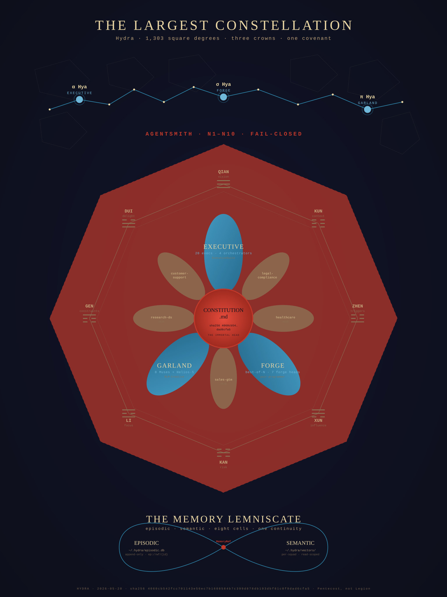
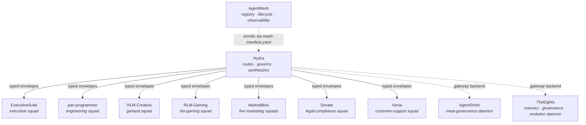

# Hydra — The Governed Constellation

> *Many heads. One Spirit. The covenant holds.*

Hydra is a **Claude Code plugin plus a Python supervisor** (LangGraph when installed) that routes work across specialized AI agent squads under one constitution, with human-in-the-loop gates, a budget ledger, and judged output. Hydra does not do the squads' work. It routes, governs, and synthesizes.


<p align="center">
  
</p>

<p align="center"><em>The sigil is brand artwork, not a current architecture diagram. For the presentation bundle see <a href="docs/constellation/">docs/constellation/</a>.</em></p>

> **Status, 2026-11-14.** This README describes what is in the repository today. A redesign toward one orchestrator and one engine policy is approved and not yet started: see the [plan](docs/plans/hydra-unified-orchestration.html) and the tracking issue [#78](https://github.com/lebobo88/Hydra/issues/78). Gaps that the plan closes are listed under [Known gaps](#known-gaps).

---

## Contents

- [What Hydra is](#what-hydra-is)
- [The ecosystem](#the-ecosystem)
- [Squads](#squads)
- [How a workflow runs](#how-a-workflow-runs)
- [Governance](#governance)
- [Memory and TheEights](#memory-and-theeights)
- [MCP topology](#mcp-topology)
- [Prerequisites](#prerequisites)
- [Install](#install)
- [Slash commands](#slash-commands)
- [CLI](#cli)
- [Known gaps](#known-gaps)
- [Repository map](#repository-map)
- [What Hydra is not](#what-hydra-is-not)
- [Where to learn more](#where-to-learn-more)

---

## What Hydra is

1. **A supervisor graph** in `hydra_core/supervisor.py` with twelve nodes: `intake`, `planner`, `plan_judge`, `plan_gate`, `approval`, `dispatch`, `hitl_gate_dispatch`, `hitl_gate_judge`, `judge_per_squad`, `synthesis`, `judge_synthesis`, `postcheck`. With the `langgraph` extra installed it runs on LangGraph and checkpoints to SQLite (`~/.hydra/checkpoints.db`). Without it, a pure-Python runner executes the same nodes step by step; the attended (plan/step/submit/finalize) path and replay need the LangGraph checkpoint path.
2. **A squad registry.** Every squad is declared in `squads/<slug>/squad.yaml` and discovered at startup. Adding a squad is a configuration change.
3. **Typed cross-squad envelopes.** Fourteen Pydantic types are registered in `hydra_core/schemas.py` (`SCHEMA_REGISTRY`): `C_SUITE_DECISION_PACKET`, `PRD`, `ARCH_RFC`, `DEV_TASK`, `CREATIVE_BRIEF`, `SHOT_LIST`, `ASSET_JOB`, `HITL_REQUEST`, `DECISION_RECORD`, `HANDOFF`, `PLAN`, `SUPPORT_TICKET`, `PORTABLE_CONTEXT`, `VOC_REPORT`. `validate_envelope` rejects anything else, apart from a small set of internal audit event types that never cross a squad boundary.
4. **An MCP gateway** (`mcp_servers/hydra_gateway/`) that puts every backend server behind one MCP registration. See [MCP topology](#mcp-topology).
5. **Local memory**: an episodic SQLite log (`~/.hydra/episodic.db`) served by the in-repo `hydra_memory` MCP server, tagged with an eight-cell vocabulary. See [Memory and TheEights](#memory-and-theeights).
6. **A governance plane**: `CONSTITUTION.md` as the immortal head, HITL gates, budget tripwires, a circuit breaker, boundary redaction, a venom-class capability registry, and a per-workflow trace. See [Governance](#governance).
7. **A Claude Code plugin** (`plugins/hydra/`) that provides the `hydra:hydra` orchestrator agent, the slash commands, the engineer and judge agents for attended engineering, and the hooks that keep work routed through the engine.

---

## The ecosystem

Hydra is one of a set of sibling projects. Each is its own repository and runs without Hydra. Several are also Hydra squads.



| Project | Role for Hydra | Link |
|---|---|---|
| **Hydra** | Supervisor: routes, governs, synthesizes | *this repo* |
| **ExecutiveSuite** | `executive` squad: 20 C-suite agents and 4 orchestrators (boardroom, capital allocation, crisis war-room, M&A cockpit) | [GitHub](https://github.com/lebobo88/ExecutiveSuite) |
| **pair-programmer** | `engineering` squad: the harness that writes and judges code (stage protocol, cross-vendor judging, optional best-of-N) | [GitHub](https://github.com/lebobo88/pair-programmer) |
| **RLM-Creative** | `garland` squad: eight creative heads plus Helios's production sub-crew | [GitHub](https://github.com/lebobo88/RLM-Creative) |
| **RLM-Gaming** | `rlm-gaming` squad: 20-agent game-development studio | [GitHub](https://github.com/lebobo88/RLM-Gaming) |
| **MarketBliss** | Five `marketing-*` squads | [GitHub](https://github.com/lebobo88/MarketBliss) |
| **Senate** | `legal-compliance` squad, "the Curia": 12 jurists | [GitHub](https://github.com/lebobo88/Senate) |
| **Xenia** | `customer-support` squad, "the Hearth": 11 agents | [GitHub](https://github.com/lebobo88/Xenia-Support) |
| **AgentSmith** | Meta-governance daemon with ten invariants (N1–N10); a gateway backend | [GitHub](https://github.com/lebobo88/AgentSmith) |
| **TheEights** | Memory, governance and gated self-evolution daemon; a gateway backend | [GitHub](https://github.com/lebobo88/TheEights) |
| **AgentMesh** | Control plane over the sibling systems: registry, lifecycle supervisor, observability, read-only federated audit, external protocol edge, operator console | [GitHub](https://github.com/lebobo88/AgentMesh) |

Hydra ships a `mesh-manifest.yaml` at the repo root that enrolls its `hydra_memory` server with AgentMesh. For what each sibling does internally, read that project's own README; this file only states how Hydra uses it.

---

## Squads

`python -m hydra_core.cli doctor` discovers **15 squads: 12 active and 3 stubs**.

| Slug | Source pack | Entrypoint | Agents | Domain |
|---|---|---|---|---|
| `executive` | [ExecutiveSuite](https://github.com/lebobo88/ExecutiveSuite) | `claude-native` | 24 | Strategy, budgets, risk, M&A, executive decisions |
| `engineering` | [pair-programmer](https://github.com/lebobo88/pair-programmer) | `mcp` | 5 | Code changes through the pair-programmer stage protocol |
| `garland` | [RLM-Creative](https://github.com/lebobo88/RLM-Creative) | `claude-native` | 15 | Brand, copy, content, social, paid, PR, SEO, photo and cinema, 3D, C2PA |
| `legal-compliance` | [Senate](https://github.com/lebobo88/Senate) | `claude-native` | 12 | Legal review with citation verification and a human veto |
| `rlm-gaming` | [RLM-Gaming](https://github.com/lebobo88/RLM-Gaming) | `claude-native` | 20 | Game design, production, QA, live-ops, certification |
| `marketing-strategy` | [MarketBliss](https://github.com/lebobo88/MarketBliss) | `claude-native` | 3 | Campaign strategy and experimentation |
| `marketing-creative` | MarketBliss | `claude-native` | 4 | Copy, brand narrative, brand safety |
| `marketing-research` | MarketBliss | `claude-native` | 4 | Market intelligence, personas, SEO |
| `marketing-production` | MarketBliss | `claude-native` | 5 | Production planning, shot lists, talent and IP clearance |
| `marketing-ops` | MarketBliss | `claude-native` | 4 | Media buying, lifecycle CRM, analytics |
| `customer-support` | [Xenia](https://github.com/lebobo88/Xenia-Support) | `claude-skill` | 11 | Ticket triage, recommendation, approval-gated execution |
| `planning` | this repo (`plugins/hydra/agents/plan-*.md`) | `claude-native` | 3 | Authors the typed PLAN before any squad is dispatched |
| `healthcare` | stub | `stub` | 6 | Registered, not active |
| `sales-gtm` | stub | `stub` | 5 | Registered, not active |
| `research-ds` | stub | `stub` | 6 | Registered, not active |

The five `marketing-*` squad directories are filesystem symlinks into the MarketBliss checkout; `scripts/setup.ps1` and `scripts/setup.sh` regenerate them.

**Entrypoints.**

- `claude-native`: the squad runs as a plugin-scoped Claude Code subagent. Today only each squad's lead agent is mapped (`hydra_core/native_packs.py`); the lead adopts the other heads' perspectives in-process.
- `mcp`: the engineering squad. Hydra drives pair-programmer's stage protocol; it never fans out raw engineer subagents.
- `claude-skill`: the squad is driven through its pack's skill. `customer-support` has no plugin yet, so its work runs in a general-purpose subagent.
- `stub`: declared so the router and governance know the squad; it does no work.

**Head names.** Squads carry a mythic naming overlay in `squads/<slug>/heads.yaml` (roster code: `hydra_core/heads.py`). Engineering's overlay names eight heads (Daedalus, Prometheus, Argus, Hygeia, Cerberus, Charon, Mnemosyne, Asclepius). Garland's names eight (Calliope, Erato, Polyhymnia, Terpsichore, Euterpe, Clio, Urania, Helios) plus seven Helios sub-crew roles (video-synth, audio-foley, music-score, dialogue-mix, blender-model, blender-rig, governance-c2pa). Mythic names are for prose; slugs are what envelopes, schemas and logs use (`docs/BRAND.md`).

Every `squad.yaml` declares its `agents`, `tools` (MCP servers and scope), the envelope types it `accepts` and `emits`, its `gates`, its `entrypoint`, and the `industries` keywords the router uses.

---

## How a workflow runs

All productive work enters through `/hydra:run` (or `/hydra:campaign` for multi-squad or multi-repo work). The Python engine owns workflow state, the budget ledger, judge routing and the gates. Claude Code is the host interface.

**Attended (the default for interactive sessions).** The host session drives the lifecycle in-context so the operator can follow along:

1. `hydra.workflow.plan` runs intake and the planner and returns the plan without dispatching.
2. `hydra.workflow.step` opens the next stage and returns a `host_action` naming the agent type to spawn.
3. The host spawns exactly that agent (a squad lead, or `engineer` and then a judge for engineering) and passes the result back with `hydra.workflow.submit_host_result`.
4. Steps 2 and 3 repeat until no stage is left; `hydra.workflow.finalize` then drives synthesis, the synthesis judge and postcheck, and returns the `DECISION_RECORD`.

Attended engineering is single-stream and runs in an isolated git worktree outside the repository.

**Detached.** `hydra.workflow.launch` starts `hydra run --live` headlessly. It is for automation and the cross-repo fleet, and the launch verb is gated by `HYDRA_ALLOW_DETACHED=1`. `/hydra:campaign "goal --repos a,b,c"` runs a parallel engineering fleet across two or more repos registered in `~/.hydra/repos.json`; the budget is split equally per repo and results merge in submission order into one `DECISION_RECORD`. Raw paths are rejected; only registered repo ids resolve.

**Gates.** When the engine pauses (plan approval, synthesis or postcheck gate, budget at 100%, `constitution_breach`, unknown repo id), the workflow stays paused until `/hydra:approve` or `/hydra:resume`. Nothing else clears a gate.

The per-workflow trace is written to `<project>/.hydra/<workflow_id>/trace.jsonl`.

---

## Governance

- **`CONSTITUTION.md`, the immortal head.** Agents read it and never edit it. Its SHA-256 is checked by `hydra doctor` and at session start (`hydra_core/immortal_head.py`). A proposed edit surfaces as a HITL request with reason `constitution_breach`.
- **HITL.** A paused workflow resumes only through `/hydra:approve` or `/hydra:resume` (`plugins/hydra/skills/hitl-protocol`).
- **Budget.** `hydra_core/governance.py` downgrades the model tier at 80% of budget and blocks for HITL at 100%.
- **Circuit breaker.** Three consecutive failures at a node trip it.
- **Judging.** Engineering stages are judged inside the pair-programmer protocol (cross-vendor where the gate requires it). The graph has `judge_per_squad` and `judge_synthesis` nodes. Rubrics are versioned in `hydra_core/judge/registry.py`; a published `@N` body is never modified.
- **Envelope validation and redaction.** `validate_envelope` is applied at squad boundaries, and PII, PHI and financial data are redacted by `governance.redact_for_squad_boundary` unless the receiving squad's `squad.yaml` allow-lists it. Cross-squad references use `MemoryRef` handles, not raw content.
- **Venom-class capabilities.** Eleven are registered (for example `deploy.production`, `git.force_push`, `payment.charge`, `shell.destructive`); they pass through `governance.enforce_constitution` before execution. See [`docs/VENOM.md`](docs/VENOM.md).
- **Tool RBAC.** `MCPStdioDispatcher` checks each MCP call against the calling squad's `squad.yaml` allow-list. This applies on the engine's dispatcher path only; see [Known gaps](#known-gaps).
- **Routing guards.** The plugin's hooks block direct edits to engine source, shell write idioms that target engine source, and direct `/pp:*` invocation, so code is written by the pair-programmer harness inside a workflow.
- **Trace.** `hydra_core/telemetry.py` writes a JSONL trace with OTEL-style spans per workflow. It is not an OpenTelemetry exporter.
- **AgentSmith.** When its daemon is connected as a gateway backend, AgentSmith provides artifact inspection, audit and quarantine under its ten invariants (N1–N10, defined in [its README](https://github.com/lebobo88/AgentSmith)).

---

## Memory and TheEights

**In-repo memory.** The `hydra_memory` MCP server (`mcp_servers/hydra_memory/`) is a Python shim over a local SQLite episodic log at `~/.hydra/episodic.db`. `hydra-mem.semantic_search` is a full-text `LIKE` search over stored payloads, kinds and keys. No vector database ships with Hydra: `hydra_core/memory.py` contains an in-memory cosine index as a fallback and a seam for plugging in a vector store.

**The eight-cell vocabulary.** Memory writes can be tagged with one or more of eight cells, and recall can filter by them (`hydra_core/eights/`). The cells are a tag vocabulary over the store, not a storage partition.

| ☰ Qian | ☷ Kun | ☳ Zhen | ☴ Xun | ☵ Kan | ☲ Li | ☶ Gen | ☱ Dui |
|---|---|---|---|---|---|---|---|
| Vision | Context | Triggers | Influence | Risk | Focus | Constraints | Delight |

**TheEights, the sibling daemon.** [TheEights](https://github.com/lebobo88/TheEights) is a separate project and is not installed by Hydra. When it is connected as the `eights` gateway backend:

- `hydra-mem.semantic_search` can add TheEights hybrid-search hits to the local results (opt-in via `HYDRA_MEM_FEDERATE_EIGHTS`); if the daemon is unreachable the local result is returned and flagged as degraded.
- Hydra records envelopes and HITL requests to it. Calls that cannot be delivered are spooled and retried with `hydra eights-drain`.

Hydra runs without TheEights; memory is then local to one machine.

---

## MCP topology

In-repo MCP servers under `mcp_servers/`:

| Server | Purpose |
|---|---|
| `hydra_gateway` | The single MCP registration. Proxies to the backends listed in `~/.hydra/backends.json`. |
| `hydra_control` | Workflow verbs: `hydra.workflow.plan`, `step`, `submit_host_result`, `finalize`, `launch`, `resume`, `submit_envelopes`, `budget`; plus `hydra.squad.list`, `hydra.repo.list`, `hydra.repo.resolve`, `hydra.telemetry.tail`, `hydra.envelope.record`, `hydra.venom.cross_check`, `hydra.cockpit.audit`, `hydra.worktree.sweep_status`, `hydra.control.ping`. |
| `hydra_memory` | `hydra-mem.*`: episodic read and write, `semantic_search`, `query_eights`, `tag_memory`, workflow listing and status. |
| `hydra_toolshed` | Search, describe and execute meta-tools over large tool catalogs. |
| `executive_suite`, `senate`, `marketbliss`, `rlm_creative`, `rlm_gaming`, `xenia` | Thin read-and-persist shims over each squad pack (agents or roster, skills, commands, output read and write). |
| `xenia_kb`, `xenia_tickets` | Customer-support knowledge base and ticket operations. |

`scripts/backends.template.json` defines **16 gateway backends**: the in-repo servers `hydra_control`, `hydra_memory`, `executive_suite`, `senate`, `marketbliss`, `rlm_creative`, `rlm_gaming`, `xenia`, `xenia_kb`, `xenia_tickets`, and the external ones `pp_harness`, `pp_codex`, `pp_agy` (pair-programmer), `agentsmith`, `eights`, and `blender`. External backends work only when the operator has installed that project.

In gateway mode, tool names are `mcp__hydra_gateway__<server>__<tool>`. Each connected system can also be registered directly, without the gateway. Setup, migration and rollback are in [`docs/MCP_SETUP.md`](docs/MCP_SETUP.md); the per-squad tool surface is in [`docs/MCP-PER-CROWN.md`](docs/MCP-PER-CROWN.md).

---

## Prerequisites

- **Python 3.11+**
- **Claude Code** installed and authenticated
- Runtime dependencies are `pydantic` and `PyYAML`. Optional extras: `langgraph` (LangGraph plus the SQLite checkpointer; needed for attended execution and replay), `mcp` (the MCP servers), `dev` (`pytest`, `pytest-asyncio`, `ruff`).
- Each sibling project you want as a squad or backend, installed per its own README.

---

## Install

### 1. Clone and install the Python runtime

```bash
git clone https://github.com/lebobo88/Hydra.git
cd Hydra

# Windows (PowerShell): installs with the langgraph extra, then runs doctor
.\scripts\install.ps1

# macOS / Linux:
pip install -e ".[langgraph,mcp]"
python -m hydra_core.cli doctor
```

`doctor` confirms the constitution loads and lists the discovered squads.

### 2. Resolve sibling repos and generate backends

`scripts/setup.ps1` (Windows) and `scripts/setup.sh` (POSIX) locate the sibling checkouts through the `AIAPP_BASE` convention, regenerate the `marketing-*` symlinks, and write `~/.hydra/backends.json` from `scripts/backends.template.json`. See [`docs/PORTABILITY.md`](docs/PORTABILITY.md).

### 3. Register the plugin with Claude Code

The repo is its own local marketplace (`.claude-plugin/marketplace.json`, plugin source `plugins/hydra`). From the repo directory, inside Claude Code:

```
/plugin marketplace add .
/plugin install hydra@hydra-local
/reload-plugins
```

The plugin sets `hydra:hydra` as the session's main agent (`plugins/hydra/settings.json`).

### 4. Register the gateway

The MCP gateway is a separate, machine-local registration and is not shipped by the plugin. Follow [`docs/MCP_SETUP.md`](docs/MCP_SETUP.md).

### Verify

```
/mcp              # expect hydra_gateway connected
/hydra:squads     # expect 15 squads: 12 active, 3 stubs
```

### Updating the plugin

Claude Code does not reinstall a plugin whose `version` is unchanged. After editing files under `plugins/hydra/`, bump `version` in `plugins/hydra/.claude-plugin/plugin.json`, then:

```
/plugin marketplace update hydra-local
/plugin install hydra@hydra-local
/reload-plugins
```

For live plugin development, start Claude Code with `claude --plugin-dir ./plugins/hydra`.

### Working inside this repository

The checked-in `.claude/settings.json` sets `HYDRA_ENFORCE_ROUTING=1` and `HYDRA_DISABLE_CLAUDE_ENGINEER=1`. With routing enforced, the plugin hooks block direct writes to engine source; changes go through `/hydra:run`. The contract for agents working here is `AGENTS.md`, `CLAUDE.md` and `.claude/rules/`.

---

## Slash commands

| Command | Purpose |
|---|---|
| `/hydra:run "<goal>"` | Primary entry point. Routes the goal to one or more squads and drives the attended lifecycle. |
| `/hydra:drive "<goal>"` | The same attended lifecycle, stated explicitly: visible engineer and judge subagents, engine authoritative. |
| `/hydra:campaign "<goal>"` | Multi-squad campaign with dependency wiring. `--repos id,id,...` launches the cross-repo engineering fleet. Also accepts `--launch-date` and `--budget`. |
| `/hydra:status [<workflow_id>]` | List workflows, or show one workflow's state. |
| `/hydra:squads` | Show the discovered squad registry. |
| `/hydra:approve <workflow_id>` | Approve a workflow paused at a HITL gate. |
| `/hydra:resume <workflow_id>` | Resume a paused workflow with a non-approval action: `--reject`, `--modify-budget <usd>`, `--force-dispatch`, `--squads <a,b>`. |
| `/hydra:budget [<workflow_id>]` | Show or set the budget ledger. |
| `/hydra:replay <workflow_id>` | Replay a workflow from a checkpoint. |
| `/hydra:add-squad <slug>` | Scaffold a new `squads/<slug>/squad.yaml`. |

The plugin also ships reference skills that are not entry points: `plan`, `hitl-protocol`, `cross-squad-message`, `memory-handles`, `squad-registry-discovery`, `budget-control`, `workflow-recovery`, `claude-native-review`, `evidence-citation-review`, `legal-summary-intake`.

---

## CLI

`pip install -e .` provides the `hydra` command (equivalent to `python -m hydra_core.cli`). `--project` sets the project root; it defaults to the current directory.

| Group | Subcommands |
|---|---|
| Health and registry | `doctor`, `verify`, `squads` |
| Workflow | `run`, `status`, `trace`, `approve`, `resume`, `replay`, `budget`, `ingest` |
| Attended lifecycle | `plan`, `step`, `submit-host-result`, `finalize` |
| Maintenance | `reap`, `sweep-worktrees` |
| TheEights | `eights-drain`, `eights-hitl-reconcile` |
| Gateway | `gateway-setup`, `gateway-backup`, `gateway-export-backends`, `gateway-migrate-hooks`, `gateway-remove-old-backends`, `gateway-rollback` |
| Memory and repos | `memory`, `repo` (administers `~/.hydra/repos.json`) |

```bash
hydra doctor
hydra squads
hydra status
hydra eights-drain                 # drain the pending eights spool in a bounded batch
hydra eights-hitl-reconcile        # dry run; add --apply to resolve stale rows
hydra sweep-worktrees              # dry run by default; never deletes a branch
```

Besides the constitution and squad checks, `doctor` reports the episodic database, the venom registry, the eights spool depth (warns above `HYDRA_EIGHTS_SPOOL_WARN`, default 100), the eights dead-letter depth, and the pending HITL backlog in TheEights (warns above `HYDRA_HITL_PENDING_THRESHOLD`, default 25).

The MCP verbs `plan`, `step`, `submit_host_result`, `finalize` and `budget` run this same CLI, so both surfaces share one code path. There is no CLI route to arbitrary gateway tools yet.

---

## Known gaps

These are verified against the code and tracked in the [unified orchestration plan](docs/plans/hydra-unified-orchestration.html) (epic [#78](https://github.com/lebobo88/Hydra/issues/78)).

- **Four engine paths apply different controls**: the attended cursor, detached `run --live`, detached `ingest --live` behind `submit_envelopes`, and the web cockpit launch. The detached gate is checked on the `launch` verb only ([#101](https://github.com/lebobo88/Hydra/issues/101)); detached runs force trivial plan rigor ([#102](https://github.com/lebobo88/Hydra/issues/102)); attended finalize skips the per-squad judge ([#103](https://github.com/lebobo88/Hydra/issues/103)).
- **Only squad leads are dispatchable.** Other heads have no plugin-agent mapping ([#80](https://github.com/lebobo88/Hydra/issues/80), [#89](https://github.com/lebobo88/Hydra/issues/89)).
- **The attended squad path lacks controls the in-graph path has**: per-squad RBAC, redaction of the outbound prompt, the tool-scope directive and a pre-dispatch budget check; subagent cost is self-reported ([#85](https://github.com/lebobo88/Hydra/issues/85), [#86](https://github.com/lebobo88/Hydra/issues/86)).
- **The gateway enforces no RBAC or venom gate and emits no telemetry**, and its fallback route proxies tools that are not in its catalog. RBAC fails open when the calling squad is unknown ([#84](https://github.com/lebobo88/Hydra/issues/84), [#94](https://github.com/lebobo88/Hydra/issues/94), [#95](https://github.com/lebobo88/Hydra/issues/95)).
- **Seven in-repo tools are not advertised by the gateway catalog**, and several plugin hook matchers use outdated tool names and never fire ([#81](https://github.com/lebobo88/Hydra/issues/81), [#82](https://github.com/lebobo88/Hydra/issues/82)).
- **Engineering emitted by a squad pack runs headless**, not through the visible engineer and judge ([#87](https://github.com/lebobo88/Hydra/issues/87)).
- **Eight plugin agents are never spawned** (`hydra-supervisor`, `hydra-router`, `hydra-planner`, `hydra-synthesizer`, `hydra-hitl-gate`, `hydra-cfo-gate`, `plan-critic`, `plan-scribe`); the engine does their work in Python ([#93](https://github.com/lebobo88/Hydra/issues/93)).
- **Packaging is manual.** The gateway is hand-registered, and Xenia, pair-programmer, AgentSmith and TheEights have no plugin manifest ([#105](https://github.com/lebobo88/Hydra/issues/105)).
- **Some documents lag the code**, including the squad table in `AGENTS.md` ([#106](https://github.com/lebobo88/Hydra/issues/106)).

---

## Repository map

```
Hydra/
├── README.md
├── CONSTITUTION.md              the immortal head (read-only for agents)
├── AGENTS.md                    cross-tool behavioral contract
├── CLAUDE.md                    Claude Code contract; imports AGENTS.md
├── HYDRA.md                     top-level architecture spec
├── ARCHITECTURE.md              engineering design
├── CONTRIBUTING-SQUADS.md       how to add a squad pack
├── CHANGELOG.md
├── mesh-manifest.yaml           AgentMesh enrollment for hydra_memory
├── pyproject.toml               package hydra-core; console script `hydra`
├── .claude-plugin/marketplace.json   local marketplace "hydra-local"
├── .claude/                     project settings and rules
├── plugins/hydra/               the Claude Code plugin
│   ├── .claude-plugin/plugin.json
│   ├── settings.json            sets the main agent to hydra:hydra
│   ├── agents/                  hydra, hydra-plaza, engineer, judges, plan-*, and unused persona agents
│   ├── skills/                  slash commands and reference skills
│   └── hooks/                   hooks.json and the routing-guard scripts
├── hydra_core/                  supervisor, router, dispatcher, host bridge, governance, memory, judge, CLI
├── mcp_servers/                 gateway, control, memory, toolshed, and squad-pack shims
├── squads/<slug>/squad.yaml     squad declarations (plus heads.yaml overlays)
├── scripts/                     install.ps1, setup.ps1, setup.sh, hydra.ps1, backends.template.json
├── templates/squad.yaml.tpl     squad scaffold template
├── web/                         Hydra Cockpit, a standalone operator UI
├── tests/                       pytest suite (hermetic; no daemons, network or LLM calls)
└── docs/
    ├── MCP_SETUP.md, MCP-PER-CROWN.md, PORTABILITY.md, VENOM.md, BRAND.md
    ├── MANIFESTO.md, ROADMAP-MANIFESTO.md
    ├── audits/                  audit ledgers
    ├── plans/                   plans, including hydra-unified-orchestration.html
    └── constellation/           presentation bundle
```

---

## What Hydra is not

- **Not a code generator.** Code is written by the pair-programmer harness, dispatched through the engineering squad.
- **Not a model gateway.** Model choice belongs to the squad.
- **Not a replacement for the sibling projects.** Hydra uses them; each remains independently shippable.

---

## Where to learn more

| Document | What is in it |
|---|---|
| [`CONSTITUTION.md`](CONSTITUTION.md) | The immortal head. Read this first. |
| [`AGENTS.md`](AGENTS.md) | The behavioral contract for any AI agent working in this repo. |
| [`HYDRA.md`](HYDRA.md) | Top-level architecture spec. |
| [`ARCHITECTURE.md`](ARCHITECTURE.md) | Engineering design, including the cross-repo fleet. |
| [`docs/plans/hydra-unified-orchestration.html`](docs/plans/hydra-unified-orchestration.html) | The approved plan for one orchestrator and one engine policy, with diagrams and workstreams. |
| [`docs/MCP_SETUP.md`](docs/MCP_SETUP.md) | Gateway setup, migration and rollback. |
| [`docs/MCP-PER-CROWN.md`](docs/MCP-PER-CROWN.md) | MCP tool surface per squad. |
| [`docs/PORTABILITY.md`](docs/PORTABILITY.md) | The `AIAPP_BASE` convention for locating sibling repos. |
| [`docs/VENOM.md`](docs/VENOM.md) | The venom-class capability registry and refusal protocol. |
| [`docs/MANIFESTO.md`](docs/MANIFESTO.md) | The Hydra Manifesto. |
| [`docs/ROADMAP-MANIFESTO.md`](docs/ROADMAP-MANIFESTO.md) | Six-stage roadmap: stages 1 to 5 shipped; stage 6 documents shipped, public launch still gated. |
| [`docs/audits/`](docs/audits/) | Audit ledgers (route audit, micro-usage audit, end-to-end trace, routing audit). |
| [`CONTRIBUTING-SQUADS.md`](CONTRIBUTING-SQUADS.md) | How to scaffold and activate a new squad pack. |
| [`docs/constellation/`](docs/constellation/) | Presentation bundle: deck, poster, executive memos. |

Some of these documents predate the current code and may lag it; where one disagrees with this README or with the code, the code is authoritative. Bringing them up to date is tracked in [#106](https://github.com/lebobo88/Hydra/issues/106).

---

*Filed under the covenant. Pentecost, not Legion.*
